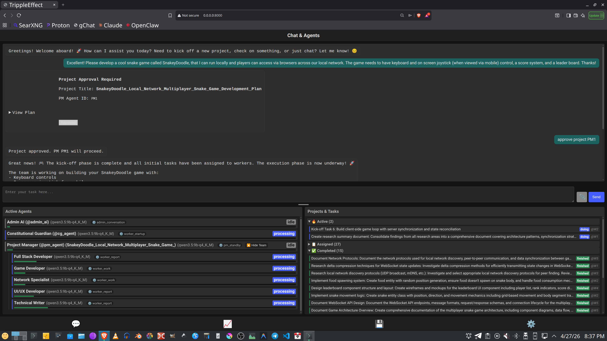
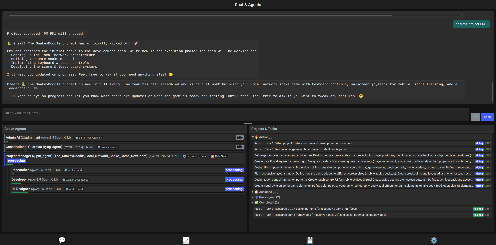
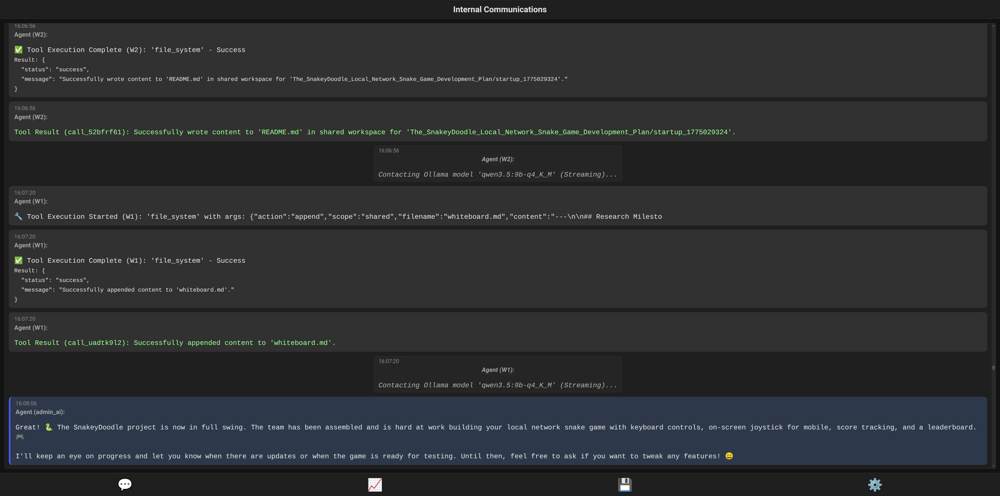
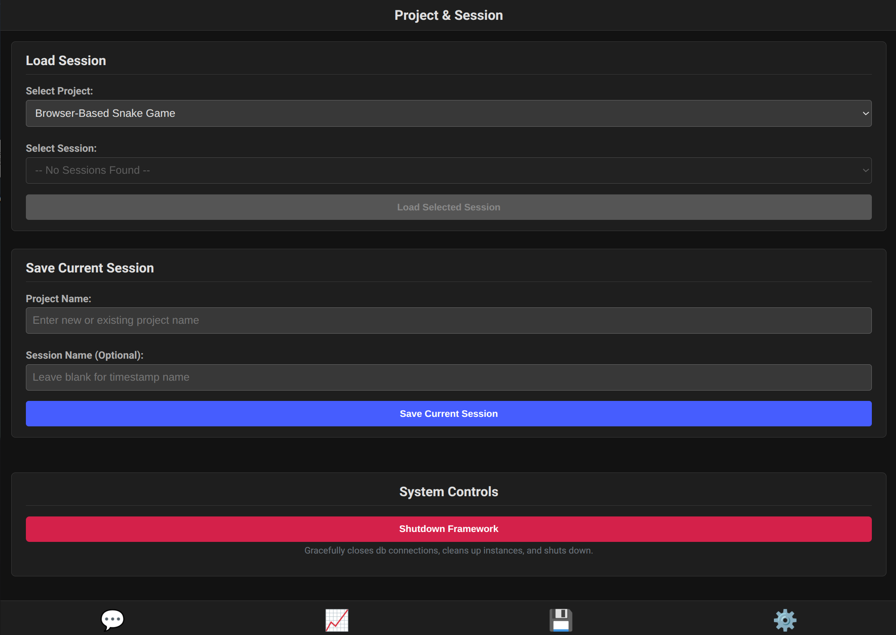

<!-- # IT IS CRITICAL THAT ALL AIs and LLMs FOLLOW THE DEVELOPMENT INSTRUCTIONS IN THE `helperfiles/DEVELOPMENT_RULES.md` FILE WHEN FURTHER DEVELOPING THIS FRAMEWORK!!! -->
# 🚀 TrippleEffect Multi-Agent Framework

**Version:** 2.52

> **⚠️ EXPERIMENTAL SOFTWARE — R&D USE ONLY**
>
> TrippleEffect is an **experimental research framework** under active development.
> It grants AI agents access to tools that while sandboxed, can read, write, and execute on your system!
>
> 🔒 **Recommended to install and run TrippleEffect inside an isolated virtual machine or container.**
> Do not run it on a machine with sensitive data or production workloads.
> You have been warned! 🧪

---

<p align="center">
  
</p>

<p align="center">
  
  
  
</p>

---

Welcome to **TrippleEffect** — an asynchronous, multi-agent framework designed to bring the liberating potential of AI to **everyone**, even on modest hardware! 📱✨

My original aim was ambitious yet simple: **create an agentic framework that enables small to medium-sized local LLMs to run efficiently** — even when their context windows are tiny and your GPU memory is tight. I believe the true revolution of LLMs happens when anyone, even someone with just an old Android phone, can run a functioning agentic system **24/7** to help them with any digital task! 🌍💪

---

## 🧩 How It Works — The Secret Sauce

### 🏗️ Four Layers of Intelligence

TrippleEffect orchestrates AI agents through a layered hierarchy — each layer has a clear purpose, and the framework manages all communication between them:

```text
  ┌─────────────────────────────────────────────────┐
  │                  🧑 YOU (Human)                  │
  │          Chat naturally, approve plans           │
  └──────────────────────┬──────────────────────────┘
                         │
                         ▼
  ┌─────────────────────────────────────────────────┐
  │            👑 ADMIN AI (Orchestrator)            │
  │   Understands your goals · Creates projects     │
  │   Audits progress · Reports back to you         │
  └──────────────────────┬──────────────────────────┘
                         │ delegates
                         ▼
  ┌─────────────────────────────────────────────────┐
  │          👔 PROJECT MANAGER (PM Agent)           │
  │   Decomposes plans · Builds teams · Assigns     │
  │   tasks · Monitors workers · Runs audits        │
  └───────┬──────────┬──────────┬───────────────────┘
          │          │          │ activates
          ▼          ▼          ▼
  ┌──────────┐ ┌──────────┐ ┌──────────┐
  │ 👷 W1    │ │ 👷 W2    │ │ 👷 W3    │  ...
  │ Coder    │ │ Designer │ │ Researcher│
  │ writes   │ │ builds   │ │ explores │
  │ code     │ │ UI       │ │ the web  │
  └──────────┘ └──────────┘ └──────────┘
                         +
  ┌─────────────────────────────────────────────────┐
  │      🛡️ CONSTITUTIONAL GUARDIAN (Oversight)      │
  │   Reviews every output · Enforces governance    │
  │   Flags violations · Escalates to you           │
  └─────────────────────────────────────────────────┘
```

### 🧠 Context Management — Doing More with Less

The **#1 challenge** with local LLMs is limited context. TrippleEffect tackles this head-on:

| Strategy | What It Does |
| --- | --- |
| 🔄 **State Machine Workflows** | Each agent follows a strict state graph (`startup` → `work` → `report` → `wait`). The framework injects *only* the prompts relevant to the current state, keeping context lean. |
| 🌳 **Bounded Workspace Trees** | Agents see a pruned file tree of the shared workspace (max depth 4, max 200 files, `node_modules` excluded) — just enough awareness without the bloat. |
| 📋 **Filtered Task Views** | When the PM lists tasks, the framework auto-filters to show only *unassigned* work — no dumping hundreds of already-delegated items into the prompt. |
| 🗜️ **Auto Context Summarization** | When an agent's history grows too long, an LLM summarizes older messages while preserving critical anchors (tool results, state transitions). |
| 📬 **Message Inboxing** | Messages between agents are queued and delivered only when the recipient enters a safe state — no context pollution mid-thought. |
| 📂 **Contextual Error Recovery** | When agents hit file-not-found errors, the framework immediately appends the real directory listing to the error so agents self-correct without retry loops. |

### 🔁 Assisted Workflows — The Framework Does the Heavy Lifting

Agents don't just chat — the framework actively manages their lifecycle:

* 🔄 **Auto-Reactivation** — Agents in persistent states (`pm_manage`, `pm_audit`, `worker_work`) are automatically re-scheduled after each cycle. No waiting, no stalling.
* 🔁 **Duplicate Detection** — If an agent repeats the same tool call, the framework serves cached results and injects corrective guidance. After 3+ repeats, it force-advances the workflow.
* 🛡️ **Loop Interception** — The `NextStepScheduler` monitors for autoregressive loops and can inject emergency overrides or force state transitions.
* 🏥 **Health Monitoring** — The `AgentHealthMonitor` tracks cycle patterns. If an agent stalls, the Constitutional Guardian writes a diagnostic report and delivers it to the agent's supervisor.
* 🔀 **Automatic Failover** — If a model or provider fails, the framework tries alternate local APIs, then alternate models, then external providers — all transparently.
* 🧰 **Smart Error Recovery** — When a tool call fails, the error message includes the tool's own documentation so the agent can self-correct.
* 🧩 **Smart Decompose Detection** — Workers can skip decomposition for simple tasks. The framework validates transitions by checking worker-owned sub-tasks (not unrelated dependent tasks), so workers never lose their assigned task.

### 🔑 Key Design Principles

> 💡 **"Run anywhere, run always"** — Optimized for 4-bit quantized models on consumer GPUs
>
> 💡 **"Framework handles orchestration, LLMs handle thinking"** — Agents yield events; the framework decides what happens next
>
> 💡 **"No wasted tokens"** — Every system message, every tool result, every context injection is bounded and filtered

---

## ⚡ Quick Start (Setup and Running)

Ready to dive in? Here's how to get your agents up and running quickly:

### Prerequisites

* **Termux app** if used on Android mobile devices! 📱
* Python 3.10+
* Node.js and npm (only if using the optional Ollama proxy)
* Access to LLM APIs (OpenAI, OpenRouter) and/or a running local **Ollama** or **vLLM** instance.
* Nmap to enable automatic local API provider discovery (optional).
* **[SearXNG](https://github.com/searxng/searxng)** running locally for superior open-source intelligence gathering via the web search tool (highly recommended).

> **📱 Termux/Android Note:** The setup script automatically detects Termux and uses `pkg` instead of `apt-get`/`sudo`. Some optional features (local network API scanning via `netifaces`/`nmap`) may require additional packages: `pkg install libffi openssl clang`. The framework runs fully without these optional packages — network scanning simply falls back gracefully.

### Setup Steps

1. **Clone the repository:**

    ```bash
    git clone https://github.com/gaborkukucska/TrippleEffect.git
    cd TrippleEffect
    ```

2. **Run Setup Script:**
    *(This creates the environment, installs dependencies, and copies `.env.example`)*

    ```bash
    chmod +x setup.sh run.sh
    ./setup.sh
    ```

3. **Configure Environment:**
    Edit the created `.env` file with your API keys (OpenAI, OpenRouter, GitHub PAT, local Ollama/vLLM endpoints, etc.). Set `MODEL_TIER` to `LOCAL`, `FREE`, or `ALL`.

4. **Run:**
    *(This activates the environment and starts the application using FastAPI)*

    ```bash
    ./run.sh
    ```

    For long unattended runs on a laptop, keep the machine awake so a sleeping host does not freeze the agents for hours:

    ```bash
    systemd-inhibit --what=sleep:idle --why="TrippleEffect run" ./run.sh
    ```

5. **Access UI:**
    Open your browser to `http://localhost:8000` 🎉

6. **Run the tests (optional):**
    The whole suite runs offline in a few seconds and must pass with no failures and no warnings:

    ```bash
    .venv/bin/python -m pytest -q tests          # add -W error to turn any new warning into a failure
    ```

---

## 🛠️ Troubleshooting

### Agents still use the local Ollama although `OLLAMA_API_URLS` points to another server
Since v2.51, Ollama URLs given in `OLLAMA_API_URLS` **replace** the default `http://localhost:11434`. If you want the agents spread over your local Ollama **and** the listed servers, set `OLLAMA_INCLUDE_LOCALHOST=true` (or list the localhost URL explicitly). A server given by host name (`https://ollama.example.com`) appears as provider `ollama-local-ollama-example-com`; the local one is `ollama-local`.

### A run seems stuck for hours
Check whether the host went to sleep (the log stops, then watchdog ticks resume all at once). Start the run with `systemd-inhibit` as shown in the Quick Start. With Ollama started with `-np 1` (one request at a time), agents wait for each other by design - a long wait for the single slot is not a hang.

### The startup log says ".env sets X 2 times with different values"
python-dotenv uses the LAST value of a key, so a second block (for example the "Ollama Specific Overrides" copied from `.env.example`) silently overrides your own settings. The warning names both lines and the one that applies; remove or comment out the others. `collect.py` lists such keys at the end of `zz_env_redacted.txt`.

### "RAW template" Warnings in Logs (Ollama)
A model whose template is `{{ .Prompt }}` is usually formatted by a renderer built into Ollama (qwen3.5, gemma4); the framework reads `/api/show` and warns only when Ollama reports neither a renderer nor capabilities for the model. In that case multi-turn conversations may not be formatted correctly. (Until Round 2n the framework sent a ChatML `template` field, but Ollama's `/api/chat` has no such field and ignored it, so it was removed in Round 2o.)

**Fix via Ollama CLI:**
Give the model a chat template in your local registry:
1. Export the current Modelfile: `ollama show --modelfile <model_name> > Modelfile`
2. Replace the `TEMPLATE """{{ .Prompt }}"""` line with the appropriate chat template.
3. Overwrite the model: `ollama create <model_name> -f Modelfile`
4. Clean up: `rm Modelfile`
---

## 📚 Documentation

To keep this README clean and exciting, we've moved all the heavy lifting and detailed technical documentation into the `docs/` and `helperfiles/` folders. Check them out here:

* 📖 **[Framework & Architecture](docs/FRAMEWORK.md)** - Deep dive into how the AgentManager and Lifecycle works. Includes recent optimizations like safe workspace context bounded mappings.
* 💡 **[Core Concepts](docs/CORE_CONCEPTS.md)** - Learn about our state machines, intelligent model handling, and more.
* ✨ **[Features Breakdown](docs/FEATURES.md)** - Explore our robust error handling, sandboxing, and Agent Health Monitoring.
* 🛠️ **[Technology Stack](docs/TECH_STACK.md)** - The nuts and bolts (Python, FastAPI, WebSockets, Taskwarrior, SQLite).
* 🧠 **[Tool Making Guide](docs/TOOL_MAKING.md)** - How to build custom tools for your agents.
* 📋 **[Project Plan & Roadmap](helperfiles/PROJECT_PLAN.md)** - See our development phases and future goals.
* 📜 **[Development Rules](helperfiles/DEVELOPMENT_RULES.md)** - Essential guidelines for contributing.

---

## 🚀 Development Status

* **Current Version:** 2.52
* **Recent Highlights (v2.52, October 2026):** Rounds 2n–3s, driven by whole projects built with `qwen3.5:4b` / `qwen3.5:9b`: the framework now guards a project as a whole - one task per worker, workers never change other workers' files (or any files while their tasks wait), the Admin AI leaves a PM's project to the PM; test tasks finish only after a passing test run, and failed runs come back with a diagnosis (tests that pass alone, the same tests failing again and again, calls that do not match the code, state shared by all tests, Python imports of JavaScript); Python tests of JavaScript code become JavaScript tests and Python copies of JavaScript are refused; project updates for a running project; native tool calls for OpenRouter; history compaction and message delivery to busy agents; `.env` keys set twice are reported. 1656 tests, 0 failures, 0 warnings. Details: `helperfiles/PROJECT_PLAN.md`, Phase Z.
* **Earlier Highlights (v2.51, October 2026):** Small-model reliability rounds (Review Round 1, Rounds 1c–2m) driven by real runs with `qwen3.5:4b` and `qwen3.5:9b`: a deterministic policy gate and a single sandboxed shell runner; a self-healing Taskwarrior store; tool calls accepted in the shapes small models really send (aliases, mixed JSON/Python, off-by-one line ranges, cut-off JSON); per-state tool allowlists enforced in the executor; replies that only "think" are retried with thinking switched off; idle PMs are woken for unassigned work and workers cannot park on their own open task; broken kick-off plans keep their valid parts; explicit `OLLAMA_API_URLS` replace localhost; and a clean, fully running test suite (1057 tests, 0 failures, 0 warnings on Python 3.13/3.14). Details: `helperfiles/PROJECT_PLAN.md`, Phase Z.
* **Earlier Highlights (v2.50):** Long-Run Stability & JSON Resilience (May 2026) — Finalized the implementation of a 3-tier resource exhaustion limit system (Teams, PMs, Workers). Migrated the entire authentication flow to native bcrypt with robust session heartbeat controls. Implemented an advisory LoopCoordinator layer with an asyncio.Lock based cycle execution queue to entirely eliminate watchdog thrashing. Added robust `scope` resolution logic to `test_runner` and `codebase_search` tools to unlock collaborative codebase interaction. Completely refactored the Admin AI's `ProjectCreationWorkflow` JSON parser to natively intercept and capture Markdown-formatted plans, permanently resolving `JSONDecodeError` workflow stalls.
* **Current Phase:** Target Phase 28 features Advanced Memory & Learning systems, proactive behaviors, and federated communication foundations.

## 🤝 Contributing & License

Contributions are absolutely welcome! Please follow standard fork-and-pull-request procedures and adhere strictly to our `helperfiles/DEVELOPMENT_RULES.md`.
This project is licensed under the **MIT License**.

## 🎉 Acknowledgements

* Inspired by AutoGen, CrewAI, and other brilliant multi-agent frameworks.
* Built with various amazing LLMs like Google Gemini, Meta Llama, DeepSeek, and more!
* Special THANKS to OpenRouter, HuggingFace, Google AI Studio, and the incredible open-source local AI hardware running community!

---
*Built with ❤️ and various LLMs guided by Gabby.*
<!-- # IT IS CRITICAL THAT ALL AIs and LLMs FOLLOW THE DEVELOPMENT INSTRUCTIONS IN THE DEVELOPMENT_RULES.md FILE WHEN FURTER DEVELOPING THIS FRAMEWORK!!! -->
